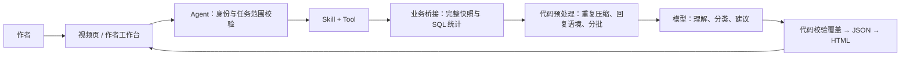

# Tianmu · 天幕

面向视频创作者的运营助手，结合视频内容理解弹幕和评论，生成可阅读的观众反馈报告。项目同时包含视频平台、Vue 前端和独立部署的 Java Agent。

业务系统负责视频、评论和弹幕的生产与分发；Agent 在作者权限内读取数据，用代码完成统计与预处理，再让模型理解反馈，最后由固定模板交付报告。

当前版本为 `0.7.0-SNAPSHOT`，仍处于开发与验收阶段。

## 目前能做什么

| 功能 | 当前行为 |
| --- | --- |
| 观众反馈报告 | 联合分析弹幕、评论及回复，呈现主要话题、相关画面、观众原话和改进建议，输出 JSON 与 HTML |
| 全量统计 | 默认读取当前视频全部已入库且仍保留的互动；明确指定日期或区间时按要求筛选 |
| 视频理解 | 读取采样画面，关联实际播放位置；缺少音频证据时不将观众的声音评价当成已核实事实 |
| 互动分析 | 展示来源数量、去重参与人数、弹幕活跃观众、发送时间趋势与视频内的弹幕分布 |
| 智能评论与弹幕 | 生成作者草稿，支持修改、勾选与确认发送；以作者账号发送，重试不重复发布 |
| 房间实时汇总 | 复用视频作为房间，由作者主动开启定时刷新；当前没有独立的直播接入系统 |
| 作者私有 Q&A | 稳定回答达到阈值后自动加入，后续可直接命中；支持停用与重新学习 |
| 执行与追踪 | 支持任务进度、取消、澄清续接、私有报告访问，以及模型和工具的 Trace |

运营助手仅向当前视频的登录作者展示，服务端还会独立校验身份与视频归属。智能评论、智能弹幕先生成草稿，用户在页面确认后才会以作者本人账号发送。

## 系统结构

```text
Tianmu/
├── src/                  视频业务后端：Java 17 / Spring Boot
├── tianmu-front/         视频网站与作者工作台：Vue 3
├── tianmu-agent/         独立 Agent：准备、执行循环、工具、报告与存储
├── deploy/               容器构建、配置模板与运维脚本
└── scripts/              冒烟、发布与部署契约检查
```

视频后端使用 MyBatis-Plus、MySQL、Redis、Netty、RocketMQ、Elasticsearch、Canal 和 MinIO，提供用户、投稿、互动、弹幕、关注、上传与检索能力。Agent 通过鉴权后的业务桥接获取数据；发送由页面确认触发，业务后端复用已有评论和弹幕入库服务，Agent 不直接修改业务库。



业务 SQL 留在根工程的 `agentbridge/`，模型协议留在 Agent 的适配器。Skill 声明能力与流程，Tool 执行受控操作；统计、去重、排序、覆盖检查和 HTML 渲染由代码完成。

## 报告如何生成

1. 固定当前作者、视频与统计范围。默认全量，截至本次请求时点；例如“昨天”“过去七天”等明确范围会覆盖默认值。
2. 在同一个业务数据库快照中读取弹幕、评论和必要的回复上下文，计算准确数量。作者发言单独标记，区间外父评论只作上下文。
3. 代码压缩文本、来源、作者身份、播放位置和回复语境均相同的表达，保留全部次数和原始 ID。不同语境的“同意”不会直接合并。
4. 模型逐批理解不同表达、归类话题并提出有依据的建议；代码累计主题与画面依据，核对每条原文的归属，不额外调用模型重写整份报告。
5. 生成统一的报告 JSON，再渲染 HTML。原话连同回复上下文统一去重，空榜单与全零图表不展示。

压缩重复表达不会减少统计数量，也不等于抽样。当前仍有完整快照、文本大小、时限与预算上限；超限明确失败，不用部分数据冒充全量报告。弹幕按播放位置统计，评论没有播放位置，不会被强行定位到某一帧。

## 快速体验 Agent

准备 JDK 17 和 Maven 3.6.3+，在仓库根目录运行：

```sh
mvn -B -f tianmu-agent/pom.xml package
java -jar tianmu-agent/target/operations-agent-0.7.0-SNAPSHOT.jar
```

默认 `demo` 模式监听 `127.0.0.1:8201`，使用模拟身份、脚本模型与内存存储，无需模型 Key、数据库或中间件。

```sh
curl -s -X POST http://127.0.0.1:8201/api/agent/runs \
  -H 'Authorization: Bearer demo-alice' \
  -H 'Content-Type: application/json' \
  -d '{"message":"查询视频1001昨天的弹幕数"}'

# 将 RUN_ID 替换为创建接口返回的 runId；未结束时可继续查询。
curl -s -H 'Authorization: Bearer demo-alice' \
  http://127.0.0.1:8201/api/agent/runs/RUN_ID
```

创建接口返回 `202`。这个示例完成后返回标记为模拟数据的弹幕数 `128`。也可以提问“你能做什么”体验 FAQ，或查询未授权视频验证权限边界。Demo 用于检查执行流程，不代表真实模型的分析质量。

免 Key 冒烟命令：

```sh
python scripts/smoke_demo.py --jar tianmu-agent/target/operations-agent-0.7.0-SNAPSHOT.jar
```

## 运行真实网站与 Agent

业务后端需要已初始化的业务库，以及 MySQL、Redis、RocketMQ、Elasticsearch、MinIO 和 Canal。Agent 的正式记录使用独立数据库，报告与证据放在私有对象存储中。

| 服务 | 启动方式 | 默认端口 |
| --- | --- | --- |
| 业务后端 | `mvn -B package`，然后运行 `target/tianmu-0.0.1-SNAPSHOT.jar` | HTTP `8101`、弹幕 WebSocket `9101` |
| Agent | 运行 Agent JAR，真实业务启用 `business,deepseek,persistent` | `8201` |
| 前端 | 在 `tianmu-front/` 执行 `npm ci` 和 `npm run serve` | 以启动输出为准 |

业务后端需开启 `AGENT_BRIDGE_ENABLED=true`。以下是 Bash 启动示例，数据库、登录与中间件配置须先由环境注入：

```sh
AGENT_BRIDGE_ENABLED=true java -jar target/tianmu-0.0.1-SNAPSHOT.jar

SPRING_PROFILES_ACTIVE=business,deepseek,persistent \
  java -jar tianmu-agent/target/operations-agent-0.7.0-SNAPSHOT.jar
```

常用配置如下，完整变量模板保存在根目录 `.env.example`。直接运行 Java 时不会自动加载 `.env`，需要通过进程环境或部署配置注入。

| 配置 | 用途 |
| --- | --- |
| `TIANMU_JDBC_URL`、`TIANMU_DB_*` | 视频业务数据库 |
| `TIANMU_REDIS_*`、`JWT_SECRET_BASE64` | 业务登录与会话；桥接必须与登录服务保持一致 |
| `BUSINESS_BASE_URL` | Agent 访问业务桥接的地址；允许回环 HTTP 或外部 HTTPS |
| `DEEPSEEK_API_KEY` | 真实文本模型凭据，由私有环境注入 |
| `HARNESS_MODEL` | Agent loop 模型，默认 `deepseek-v4-pro` |
| `AGENT_JDBC_URL`、`AGENT_DB_*`、`AGENT_REDIS_*` | Agent 正式记录与缓存 |
| `TIANMU_MINIO_*`、`AGENT_MINIO_BUCKET` | 业务文件与 Agent 私有报告存储 |
| `AGENT_MAX_MODEL_CALLS`、`AGENT_MAX_TOKENS` | 模型调用次数与 Token 预算 |

前端开发代理默认将 `/api` 转发至 `127.0.0.1:8101`，将 `/api/agent` 转发至 `127.0.0.1:8201`；分别使用 `TIANMU_API_PROXY_TARGET` 与 `TIANMU_AGENT_PROXY_TARGET` 覆盖。弹幕 WebSocket 地址可用 `VUE_APP_DANMU_WS_BASE_URL` 指定。`npm run build` 输出生产静态文件到 `tianmu-front/dist/`。

真实模型调用会产生费用。默认每个任务最多 16 次模型调用、64,000 Token，文本与视频等模型共享预算；环境变量可以覆盖这些值。相同作者、内容快照、视频事实和请求条件可复用一小时内的分类结果；全量内容不变时，仅统计时点变化不会重复分类。

## 测试与部署

从仓库根目录执行：

```sh
mvn -B verify
mvn -B -f tianmu-agent/pom.xml verify
python scripts/test_deployment.py
python scripts/check_publication.py
git diff --check

cd tianmu-front
npm ci
npm run test:agent
npm run build
```

默认测试与 CI 不调用付费模型。真实 MySQL / Redis 集成测试需要隔离环境，并显式启用 `AGENT_STORAGE_IT=true`。

`deploy/manage.py` 提供独立 Agent 栈的初始化、构建、启动和验证；`deploy/site/` 提供网站、业务后端与真实 Agent 的单机部署。凭据保存在源码之外，部署时记录源码版本和镜像摘要，并保留可回退的版本。当前持久化支持单个 Agent 写实例；网站部署中 Agent 与业务容器共享网络命名空间，更换业务容器时需要一并重建 Agent。

## 当前边界与开发入口

- 默认全量指当前已入库且仍保留的数据，不包含已删除记录或尚未持久化的消息。
- 视频理解基于采样画面，不等于连续动作分析；没有音频证据时不能核实配乐、对白或收音。
- 热门视频的海量互动扩容、后台作业自动续跑、多实例调度和按金额结算的费用预算仍待完善。
- 智能评论第一版支持作者独立留言；尚不支持自动回复、置顶或定时发布。弹幕保存到视频播放时间轴，不自动开启实时轮询。

日常使用与本地体验所需信息已放在本文。需要扩展代码时再阅读 [Agent 开发说明](tianmu-agent/README.md)；配置服务器时阅读 [部署操作说明](deploy/README.md)。其他专题资料保留在 `docs/` 与 `tianmu-agent/docs/`，无需逐篇阅读后才能启动项目。

贡献时应同时说明行为变化、权限边界与验证结果。仓库采用 MIT 许可证；许可、安全报告和第三方组件说明分别保存在 `LICENSE`、`SECURITY.md`、`NOTICE` 与 `docs/THIRD_PARTY.md`。
