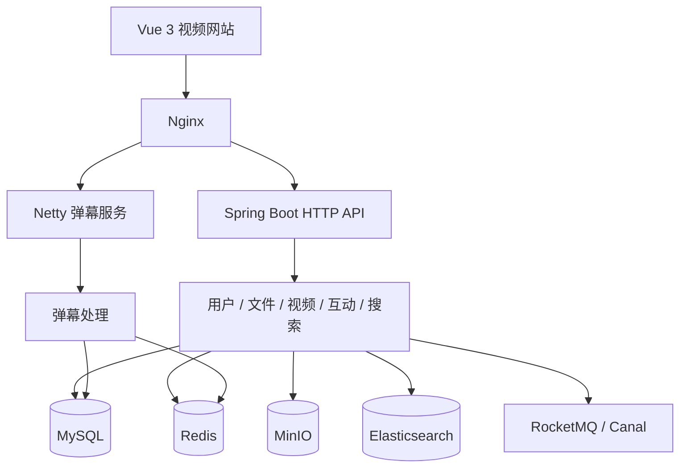
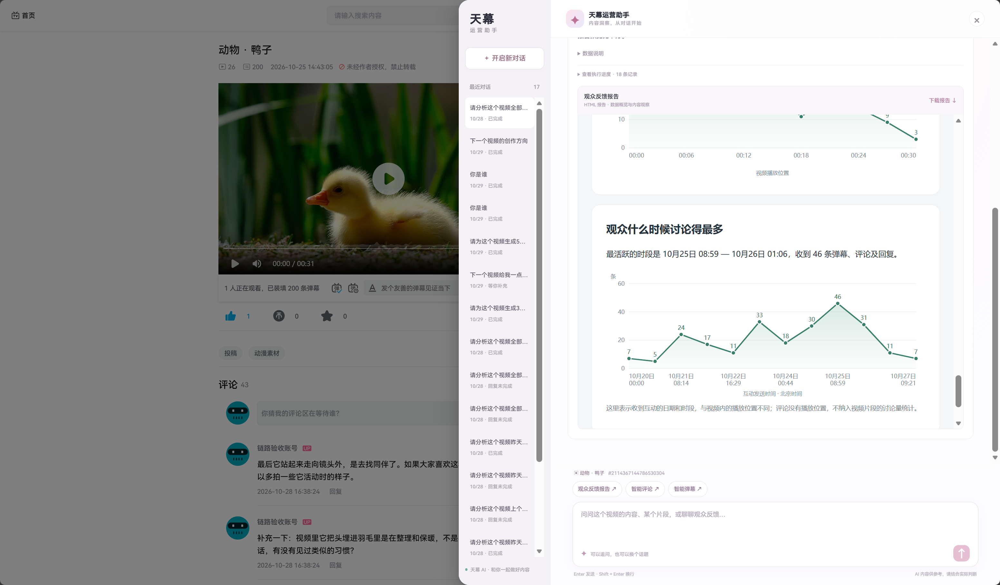
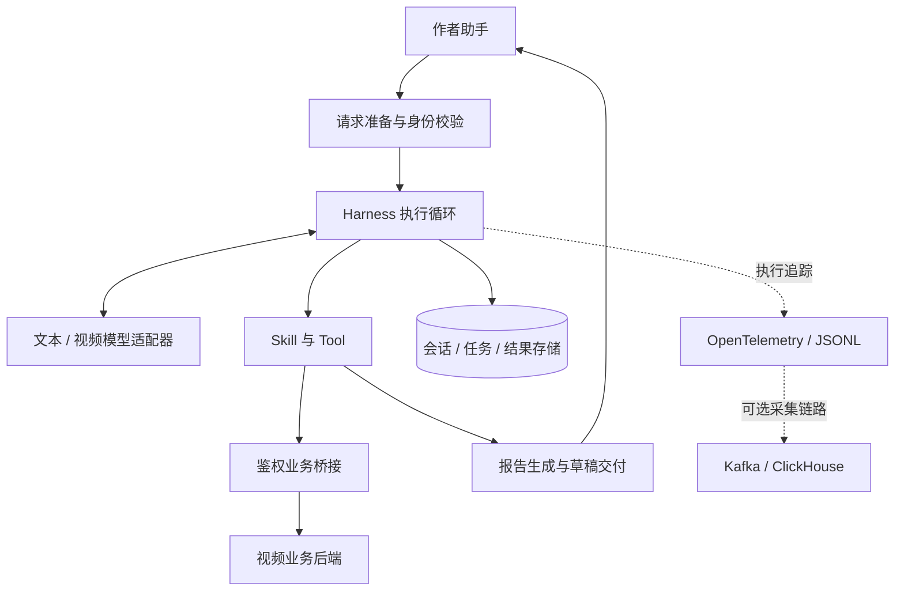

<div align="center">

# Tianmu · 天幕

**面向视频创作者的开源视频平台与 AI 运营助手**

连接视频内容、弹幕与评论，让创作者更好地理解观众，规划内容，开展互动。

[](https://github.com/blackirlsama/Tianmu/actions/workflows/ci.yml)
[](LICENSE)
[](pom.xml)
[](tianmu-front/package.json)
[](https://github.com/blackirlsama/Tianmu/stargazers)

[功能特性](#功能特性) · [后端架构](#后端架构) · [Agent 架构](#agent-架构) · [快速开始](#快速开始) · [文档](#文档) · [贡献](#参与贡献)

</div>


## 项目介绍

天幕是一套基于 **Spring Boot + Vue 3** 的视频平台，提供视频上传、播放、搜索、弹幕、评论和用户互动能力，并集成独立部署的 **Java Agent**，帮助创作者从观众反馈中发现内容方向。

视频后端负责业务与数据，Agent 负责理解需求、调用工具和生成结果。两者通过鉴权接口连接，可以分别开发、测试与部署。

> 当前为开发预览版本。可以先运行无需模型 Key 的 Agent Demo，或独立体验 Trace Studio，再接入完整网站和真实模型。

## 功能特性

| 模块 | 能力 |
| --- | --- |
| **视频平台** | 视频上传与播放、内容分类、检索、关注及互动 |
| **弹幕与评论** | 弹幕发送与展示、评论及回复、互动数据统计 |
| **观众反馈报告** | 联合分析弹幕与评论，结合画面生成可阅读的 HTML 报告 |
| **视频理解** | 画面概括、指定片段分析、内容选题建议 |
| **智能互动** | 生成作者评论与弹幕草稿，编辑确认后发布 |
| **对话助手** | 多轮沟通、任务进度、取消与结果查看 |
| **配置化问答** | 人工维护常见问题与标准回答 |
| **Trace Studio** | 调用关系图、时间线、节点详情与日志导入 |

在自己的视频页打开助手，可以这样开始：

```text
分析这个视频的弹幕和评论，结合画面生成观众反馈报告。
概括这个视频的画面内容，重点描述最后一个片段。
结合当前视频，给我几个下一条视频的选题方向。
生成几条引导观众讨论的作者评论，先给我草稿。
```

## 后端架构

视频后端采用模块化单体结构，围绕用户、文件、视频、互动与搜索组织业务。HTTP 接口承接网站请求，Netty 处理弹幕长连接，中间件提供缓存、检索、对象存储与异步处理能力。



| 层次 | 技术与职责 |
| --- | --- |
| 接入层 | Nginx 反向代理、HTTP API、WebSocket |
| 业务层 | Spring Boot、MyBatis-Plus；用户、视频、上传、互动与搜索 |
| 实时通信 | Netty；弹幕连接与消息分发 |
| 数据存储 | MySQL 保存业务数据，Redis 提供缓存，MinIO 保存媒体文件 |
| 搜索与同步 | Elasticsearch、RocketMQ、Canal；检索、异步消息与数据变更处理 |

业务后端代码位于 [`src/`](src/)，部署说明见[完整网站部署](deploy/site/README.md)。

## Agent 架构



Agent 是独立的 Spring Boot 服务。它接收用户需求，通过 Harness 执行模型与工具调用，使用 Skill 组织能力，并通过业务桥接访问视频平台。报告由结构化结果渲染，执行过程通过 Trace 记录。



| 组件 | 职责 |
| --- | --- |
| 请求准备 | 识别任务，确定当前视频与访问范围 |
| Harness | 管理执行循环、模型调用、工具调度与任务生命周期 |
| Skill / Tool | 组织业务能力，提供受控的数据读取与操作入口 |
| 模型适配器 | 对接文本模型、视频理解等外部服务 |
| 结果与存储 | 保存对话和任务，交付报告、草稿及其他产物 |
| 可观测性 | 记录调用关系、状态、耗时与用量，辅助调试和分析 |

Agent 不直接修改业务数据库，发布操作由用户确认后交给业务后端执行。详细开发与配置说明见 [`tianmu-agent/README.md`](tianmu-agent/README.md)。

## 快速开始

### 环境准备

| 组件 | 环境 |
| --- | --- |
| 后端与 Agent | JDK 17、Maven 3.6.3+ |
| 前端 | Node.js 22、npm |
| 完整网站 | MySQL、Redis、MinIO、Elasticsearch、RocketMQ、Canal 等，见部署文档 |

```bash
git clone --depth 1 https://github.com/blackirlsama/Tianmu.git
cd Tianmu
```

仓库包含约 185 MB 的[视频素材](materials/README.md)，首次拉取需要下载这些文件。

### 方式一：体验 Agent Demo

**无需模型 Key、数据库或中间件。** 在仓库根目录执行：

```bash
mvn -B -f tianmu-agent/pom.xml package
java -jar tianmu-agent/target/operations-agent-0.7.0-SNAPSHOT.jar
```

服务默认运行在 `http://127.0.0.1:8201`。另开终端创建任务：

```bash
curl -s -X POST http://127.0.0.1:8201/api/agent/runs \
  -H 'Authorization: Bearer demo-alice' \
  -H 'Content-Type: application/json' \
  -d '{"message":"查询视频1001昨天的弹幕数"}'
```

将返回的 `runId` 替换到下方命令中，查看执行结果：

```bash
curl -s -H 'Authorization: Bearer demo-alice' \
  http://127.0.0.1:8201/api/agent/runs/RUN_ID
```

Demo 使用模拟身份和脚本模型，不调用付费服务。以上为 Bash 命令；PowerShell 可使用 `curl.exe`，并将请求命令写在一行。

### 方式二：体验 Trace Studio

```bash
cd tianmu-front
npm ci
npm run serve
```

打开终端显示的开发服务器地址，访问 `/trace`，通常为 `http://localhost:8080/trace`。页面内置演示日志，也支持导入真实的 JSON / JSONL 日志；文件在浏览器本地解析。

当前版本提供离线可视化，尚未连接在线 Trace 查询。更多说明见[前端文档](tianmu-front/README.md)。

### 方式三：运行完整网站

先按[网站部署说明](deploy/site/README.md)初始化业务库和中间件，再参考 [`.env.example`](.env.example) 注入配置。直接运行 Java 不会自动读取 `.env` 文件。

在仓库根目录构建后端与 Agent：

```bash
mvn -B package
mvn -B -f tianmu-agent/pom.xml package
```

分别在两个 Bash 终端启动服务：

```bash
# 视频业务后端
AGENT_BRIDGE_ENABLED=true java -jar target/tianmu-0.0.1-SNAPSHOT.jar
```

```bash
# 接入真实业务、模型和持久化存储的 Agent
SPRING_PROFILES_ACTIVE=business,deepseek,persistent \
  java -jar tianmu-agent/target/operations-agent-0.7.0-SNAPSHOT.jar
```

然后启动前端：

```bash
cd tianmu-front
npm ci
npm run serve
```

| 服务 | 默认地址 |
| --- | --- |
| 业务 API | `http://127.0.0.1:8101` |
| Agent API | `http://127.0.0.1:8201` |
| 弹幕 WebSocket | 端口 `9101` |
| 前端 | 以开发服务器输出为准 |

真实模式需配置数据库、登录、中间件及模型凭据，模型调用可能产生费用。前端代理、外部 FAQ 和模型参数的配置分别见[前端说明](tianmu-front/README.md)、[Agent 说明](tianmu-agent/README.md)。容器部署可选择[独立 Agent 栈](deploy/README.md)或[完整网站栈](deploy/site/README.md)。

## 项目结构

```text
Tianmu/
├── src/                  视频业务后端
├── tianmu-front/         视频网站、作者助手与 Trace Studio
├── tianmu-agent/         独立 Agent 服务
├── materials/            视频素材与文件清单
├── deploy/               容器与部署配置
├── scripts/              测试、冒烟与发布检查
└── docs/                 专题文档与路线图
```

## 开发与测试

后端与 Agent：

```bash
mvn -B verify
mvn -B -f tianmu-agent/pom.xml verify
```

前端：

```bash
cd tianmu-front
npm ci
npm run test:agent
npm run build
```

[GitHub Actions](https://github.com/blackirlsama/Tianmu/actions/workflows/ci.yml) 检查前端、业务后端、Agent 与发布规范，并在隔离环境中运行数据库集成测试。测试不调用付费模型；完整验证流程见[贡献指南](CONTRIBUTING.md)。

## 文档

| 文档 | 内容 |
| --- | --- |
| [前端开发](tianmu-front/README.md) | 页面、Trace Studio、代理与构建 |
| [Agent 开发](tianmu-agent/README.md) | 执行框架、模型、工具与配置 |
| [网站部署](deploy/site/README.md) | 完整网站与真实 Agent 接入 |
| [独立 Agent 部署](deploy/README.md) | 单独运行 Agent 与存储服务 |
| [部署参考](docs/DEPLOYMENT.md) | 环境与集成测试 |
| [项目路线图](docs/ROADMAP.md) | 开发方向与待完善能力 |

## 参与贡献

欢迎提交问题、改进体验、补充测试或完善文档。

1. 在 [Issue](https://github.com/blackirlsama/Tianmu/issues) 中说明问题或使用场景。
2. Fork 仓库，从最新 `master` 创建开发分支。
3. 完成修改与相关测试，提交 [Pull Request](https://github.com/blackirlsama/Tianmu/pulls)。

提交前请阅读 [CONTRIBUTING.md](CONTRIBUTING.md)。安全问题请通过 [SECURITY.md](SECURITY.md) 中的方式反馈。感谢每一位[贡献者](https://github.com/blackirlsama/Tianmu/graphs/contributors)，也欢迎用 Star 支持项目。

## 许可证

项目代码采用 [MIT License](LICENSE)。第三方组件与视频素材遵循各自的授权条款，详见 [NOTICE](NOTICE) 与[第三方说明](docs/THIRD_PARTY.md)。
