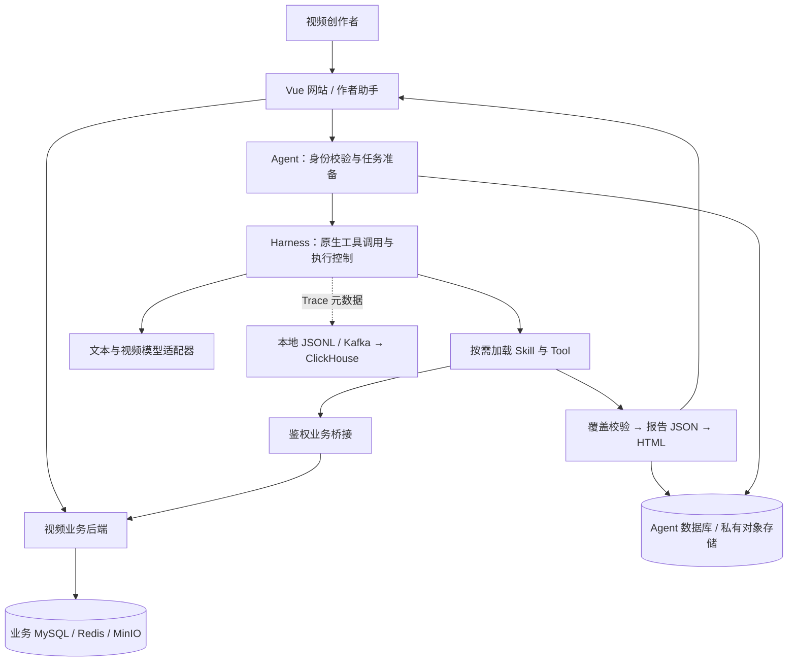

<div align="center">

# Tianmu · 天幕

**看懂视频里的内容，也看见屏幕另一端的观众。**

面向视频创作者的开源运营助手，连接视频画面、弹幕与评论，
将观众反馈整理成有来源、可阅读、可行动的内容复盘。

[](https://github.com/blackirlsama/Tianmu/actions/workflows/ci.yml)
[](LICENSE)
[](pom.xml)
[](tianmu-front/package.json)
[](https://github.com/blackirlsama/Tianmu/stargazers)

[快速开始](#快速开始) · [核心能力](#核心能力) · [系统架构](#系统架构) · [配置与部署](#配置与部署) · [参与贡献](#参与贡献)

</div>


<p align="center"><sub>视频平台首页。AI 助手位于作者视频页，Trace Studio 提供独立的执行追踪界面。</sub></p>

## 项目介绍

创作者收到的反馈散落在弹幕、评论和回复中。同一句“这里很好看”，可能在不同播放位置表达不同的意思；一条“希望保留原声”，也不能仅凭视频截图判断是否合理。

**天幕把内容与反馈放在一起理解。** 它在当前作者的授权范围内读取视频和互动记录，用代码计算数量、保留回复语境与播放位置，再让模型归纳话题、关联画面并提出建议，最终交付结构化数据和 HTML 报告。

仓库包含一套视频业务后端、Vue 网站和独立 Java Agent。你可以把它用于创作者反馈复盘，也可以研究一个 Agent 如何接入真实业务：从身份校验、原生工具调用、多轮对话，到可取消任务、私有报告与执行追踪。

> 当前为 `0.7.0-SNAPSHOT` 开发预览版本。免 Key Demo 可独立体验；真实网站与模型接入需要配置业务服务、存储及模型凭据。功能边界见[当前限制](#当前限制)。

## 核心能力

| 能力 | 你可以做什么 | 实现说明 |
| --- | --- | --- |
| **观众反馈报告** | 联合分析弹幕、评论及回复，了解观众在讨论什么 | 全量分批归类、覆盖检查、观众原话、画面关联、JSON 与 HTML 交付 |
| **视频内容理解** | 概括画面、查看指定片段、寻找下一条视频的灵感 | 带播放时间的采样事实；声音分析受实际音频证据约束 |
| **互动统计** | 查看反馈数量、参与人数与讨论分布 | 代码计算统计值，区分发送时间与视频播放位置 |
| **智能评论与弹幕** | 生成作者草稿，修改、勾选后确认发送 | 以作者身份发布，不冒充观众；生成草稿不会自动发送 |
| **多轮对话** | 围绕当前视频承接追问、切换目标、按需查阅旧消息 | 当前视频由服务端校验；会话正文与任务状态持久化 |
| **人工配置 FAQ** | 维护常见问题与批准回答，命中后直接回复 | JSON 配置、问法别名、版本标识，可指定外部配置文件 |
| **Trace Studio** | 查看调用关系、时间线和节点输入输出 | 支持本地导入 JSON / JSONL；当前尚未接入在线查询 |
| **视频平台** | 上传与播放视频，使用弹幕、评论、搜索和关注等能力 | Vue 3 前端与 Spring Boot 业务后端，Agent 通过业务桥接接入 |

### 从一个具体问题开始

在自己有权限的视频页打开助手，可以这样提问：

```text
请分析这个视频全部的弹幕和评论，结合实际画面生成观众反馈报告。

请概括这个视频的画面内容，重点描述最后一个片段。

结合当前视频，给我几个下一条视频的选题方向。

请生成几条引导观众讨论的作者评论，先给我草稿。
```

报告可以回答“哪些话题反复出现”“观众具体说了什么”“反馈对应哪个片段”“接下来可以尝试什么”。涉及实际数量、视频内容和发布操作的请求，仍须读取相应数据、校验权限或由用户确认，不会用固定 FAQ 代替业务执行。

## 设计取舍

- **统计交给代码，理解交给模型。** 数量、来源、排序、重复压缩与覆盖检查不依赖模型估算；模型负责理解表达、归类和提出建议。
- **保留每条反馈的分量。** 完全重复的表达可以压缩输入，但原始记录和出现次数保留。五条相同反馈仍计五条，正文引用去重不改变统计数量。
- **让结论有出处。** 报告保留观众原话、评论回复语境和可用的播放位置；作者发言单独标记，不作为观众需求证据。
- **让操作可控。** Skill 按需开放工具，工具结果受固定任务范围约束；草稿交付与实际发布分开，发布前必须确认。
- **让执行可检查。** 任务提供进度、取消和结果引用；Trace 记录模型与工具调用、耗时、用量及私有详情引用。
- **减少重复推理。** 视频事实与相同内容快照的报告分类可以复用；缓存命中仍检查权限，数据变化后重新判断。

## 快速开始

### 选择体验方式

| 你想体验什么 | 所需环境 | 从这里开始 |
| --- | --- | --- |
| Agent 创建任务、FAQ、SSE 与报告交付 | JDK 17、Maven 3.6.3+ | [免 Key Agent Demo](#免-key-agent-demo) |
| Trace 调用图、时间线与日志导入 | Node.js 22、npm | [Trace Studio](#trace-studio) |
| 视频网站与真实作者助手 | 上述环境、业务中间件、模型及存储配置 | [真实业务接入](#真实业务接入) |

先获取代码：

```bash
git clone --depth 1 https://github.com/blackirlsama/Tianmu.git
cd Tianmu
```

仓库包含约 185 MB 的[视频素材](materials/README.md)，首次拉取会一并下载。项目启动不要求你先导入这些素材。

### 免 Key Agent Demo

在仓库根目录执行：

```bash
mvn -B -f tianmu-agent/pom.xml package
java -jar tianmu-agent/target/operations-agent-0.7.0-SNAPSHOT.jar
```

默认监听 `127.0.0.1:8201`。Demo 使用模拟身份、脚本模型与内存存储，**无需模型 Key、数据库或中间件，也不会调用付费模型**。

另开一个终端创建任务：

```bash
curl -s -X POST http://127.0.0.1:8201/api/agent/runs \
  -H 'Authorization: Bearer demo-alice' \
  -H 'Content-Type: application/json' \
  -d '{"message":"查询视频1001昨天的弹幕数"}'
```

接口返回 HTTP `202` 和任务 `runId`。将下面的 `RUN_ID` 替换为实际值，读取状态与答案：

```bash
curl -s -H 'Authorization: Bearer demo-alice' \
  http://127.0.0.1:8201/api/agent/runs/RUN_ID
```

该示例完成后返回标记为模拟数据的弹幕数 `128`。你也可以发送“你能做什么”体验固定问答，或使用未授权视频检查权限边界。Demo 展示执行流程，不代表真实模型的分析质量。

验证整条 Demo 链路：

```bash
python scripts/smoke_demo.py --jar tianmu-agent/target/operations-agent-0.7.0-SNAPSHOT.jar
```

检查内容包括未登录访问、FAQ、Harness、SSE、私有 HTML 报告及 Trace 详情脱敏。以上 `curl` 示例使用 Bash 续行语法；PowerShell 可用 `curl.exe` 并将命令写在一行。

### Trace Studio

```bash
cd tianmu-front
npm ci
npm run serve
```

打开开发服务器输出的地址并访问 `/trace`，通常是 `http://localhost:8080/trace`。

- 三栏布局展示运行信息、可缩放平移的调用图和节点详情。
- 调用图、节点列表与时间线联动，查看耗时、状态、Token、输入输出与原始属性。
- 内置正常完成和工具超时两份**合成演示日志**。
- 可导入 Tianmu TraceEnvelope JSON 数组、JSONL，或包含 `spans` 与 `details` 的 JSON。

页面无需登录和后端，导入文件在浏览器本地解析，不上传服务器。真实 Span 只有详情引用时，页面会显示“未提供”；不会用演示正文填充真实日志。目前在线 Span 查询与私有详情加载尚待接入，格式说明见[前端文档](tianmu-front/README.md#trace-studio-第一版)。

## 系统架构



业务系统负责视频、弹幕和评论的生产与分发；Agent 通过鉴权桥接读取数据，**不直接修改业务数据库**。用户确认发送草稿后，业务后端复用既有评论、弹幕入库服务完成发布。

### 一份报告的生成过程

1. **固定范围**：确认作者、视频和时间区间。未指定时间时读取截至本次请求时点的全部保留互动。
2. **读取快照**：在同一业务数据快照内获取弹幕、评论和必要的回复上下文，计算准确数量。
3. **代码预处理**：压缩文本及语境完全相同的表达，保留全部原始 ID 和出现次数，按批次提供完整原文。
4. **模型理解**：逐批归类话题，结合视频采样事实解释反馈，提出有依据的建议。
5. **校验与交付**：代码累计归属和次数，检查完整覆盖，生成报告 JSON，再渲染 HTML。

区间外父评论仅作语境，不额外计数。弹幕的播放位置与评论的发送日期是两条时间轴，不会强行对齐。原文或预算超限时明确返回未完成，不用部分分析冒充全量报告。

### 技术栈与存储分工

| 层次 | 技术与职责 |
| --- | --- |
| 前端 | Vue 3、Pinia、Element Plus、Artplayer、Vue Flow |
| 业务后端 | Java 17、Spring Boot 3.5、MyBatis-Plus；视频、投稿与互动接口 |
| 业务基础设施 | MySQL、Redis、MinIO、Netty、RocketMQ、Elasticsearch、Canal |
| Agent | 独立 Spring Boot 服务；准备、执行循环、工具、证据与报告 |
| 对话与状态 | MySQL 保存会话、原文和任务状态；Redis 缓存可重建的授权历史窗口 |
| 报告与证据 | 文件或私有对象存储保存内容，数据库保存归属与引用 |
| 可观测性 | OpenTelemetry、JSONL，可选 Kafka / ClickHouse 链路 |

## 配置与部署

### 真实业务接入

完整网站需要已初始化的业务库及 MySQL、Redis、RocketMQ、Elasticsearch、MinIO、Canal 等服务。Agent 使用独立数据库保存任务和会话记录。

| 服务 | 启动方式 | 默认端口 |
| --- | --- | --- |
| 业务后端 | `mvn -B package`，运行 `target/tianmu-0.0.1-SNAPSHOT.jar` | HTTP `8101`；弹幕 WebSocket `9101` |
| Agent | 运行 Agent JAR，启用 `business,deepseek,persistent` | `8201` |
| 前端 | `tianmu-front/` 下执行 `npm ci`、`npm run serve` | 以开发服务器输出为准 |

以下业务后端和 Agent 命令均从仓库根目录执行。配置好登录、数据库、中间件及模型凭据后，在 Bash 中启动：

```bash
AGENT_BRIDGE_ENABLED=true java -jar target/tianmu-0.0.1-SNAPSHOT.jar
```

另开终端运行 Agent：

```bash
SPRING_PROFILES_ACTIVE=business,deepseek,persistent \
  java -jar tianmu-agent/target/operations-agent-0.7.0-SNAPSHOT.jar
```

> 网站登录凭证与 Demo 凭证属于不同的身份体系。真实网站需配合 `business` 适配器使用；Demo 的 `demo-alice` 不用于真实业务登录，也不应暴露到公网。

### 关键配置

完整模板见 [`.env.example`](.env.example)。直接运行 Java **不会自动加载 `.env`**，需要通过进程环境、Spring 配置或容器部署注入。

| 配置 | 用途 |
| --- | --- |
| `TIANMU_JDBC_URL`、`TIANMU_DB_*`、`TIANMU_REDIS_*` | 视频业务数据库与缓存 |
| `JWT_SECRET_BASE64` | 业务身份签名，登录服务与桥接须使用一致的私有值 |
| `BUSINESS_BASE_URL` | Agent 访问业务桥接的地址，支持回环 HTTP 或外部 HTTPS |
| `DEEPSEEK_API_KEY`、`DEEPSEEK_BASE_URL`、`HARNESS_MODEL` | 文本模型凭据、服务地址与执行模型 |
| `AGENT_JDBC_URL`、`AGENT_DB_*`、`AGENT_REDIS_*` | Agent 正式记录与历史缓存 |
| `TIANMU_MINIO_*`、`AGENT_MINIO_BUCKET` | 业务媒体与 Agent 私有产物存储 |
| `AGENT_MAX_MODEL_CALLS`、`AGENT_MAX_TOKENS` | 单任务模型调用次数与 Token 上限 |
| `AGENT_FAQ_LOCATION` | 人工固定问答配置，可指定外部 JSON 文件 |

前端 `/api` 默认代理到 `127.0.0.1:8101`，`/api/agent` 优先代理到 `127.0.0.1:8201`；可通过 `TIANMU_API_PROXY_TARGET`、`TIANMU_AGENT_PROXY_TARGET` 覆盖。弹幕 WebSocket 使用 `VUE_APP_DANMU_WS_BASE_URL` 配置。生产构建输出到 `tianmu-front/dist/`，须由 Web 服务器配置 API、SSE、WebSocket 代理及 SPA 回退，详见[前端部署说明](tianmu-front/README.md#生产接入)。

### 人工维护 FAQ

生产默认载入 [`faq/business.json`](tianmu-agent/src/main/resources/faq/business.json)，预置 15 条常见问答。配置项格式如下：

```json
[
  {
    "id": "creator-help",
    "version": "1",
    "questions": ["怎么使用创作者助手", "怎么使用创作者助手？"],
    "text": "登录并打开自己有权限的视频，在助手中说明想了解的数据、希望生成的报告或需要的草稿。"
  }
]
```

问法精确匹配，仅去除输入首尾空白；新增别名、编辑答案和删除条目均通过配置完成。可设置 `AGENT_FAQ_LOCATION=file:/opt/tianmu/faq/business.json` 替换整份内置配置，重启 Agent 后生效；Docker 使用容器内路径并只读挂载文件。重复 ID、重复问法、无效或缺失文件会导致启动失败，不静默使用错误配置。

人工 FAQ 命中后直接回答，不调用模型。自动积累的作者私有 Q&A 是另一条独立机制，规则和配置说明见 [Agent 文档](tianmu-agent/README.md#作者入口与-qa)。

### 预算与缓存

真实模型会产生费用。基础配置默认每任务最多 16 次模型调用、64,000 Token；实际值可由 profile 和环境变量覆盖。`.env.example` 中的 `AGENT_MAX_TOKENS=0` 表示关闭 Token 上限，接入真实模型前请按自己的成本要求设置。

文本、视频理解和转写共用任务预算。模型未报告用量时保留“未报告／部分统计”状态，不把估算值当成实际消耗。视频事实和报告分类可按授权范围、内容版本与请求条件复用；缓存不替代访问校验，也不把历史统计时间冒充当前时间。

### 容器部署

- [独立 Agent 栈](deploy/README.md)：包含专用存储和验证流程，默认可用模拟模型搭配真实存储验收。
- [完整网站部署](deploy/site/README.md)：视频平台、业务后端、真实 Agent 与单机验收说明。
- [部署与集成测试参考](docs/DEPLOYMENT.md)：环境注入、隔离服务及部署约束。

凭据放在源码之外，通过私有环境或 secret 文件注入。当前持久化支持单个 Agent 写实例；完整网站部署中 Agent 与业务容器共享网络命名空间，更换业务容器时需要相应重建 Agent。

## 工程目录

```text
Tianmu/
├── src/                         视频业务后端
│   └── main/java/.../agentbridge/  鉴权业务桥接与业务 SQL
├── tianmu-front/                视频网站、作者助手与 Trace Studio
├── tianmu-agent/                独立 Agent 服务
│   └── src/main/resources/
│       ├── skills/              按需开放的能力与流程
│       ├── tools/               工具声明与参数约束
│       ├── prompts/             版本化提示词
│       ├── faq/                 人工维护的固定问答
│       └── db/migration/        Agent 数据库迁移
├── materials/                   24 段视频素材及文件校验清单
├── deploy/                      容器、配置模板与部署脚本
├── scripts/                     冒烟、发布与部署契约检查
└── docs/                        部署、安全、来源与路线图
```

业务 SQL 留在业务桥接，模型协议留在适配器；统计和渲染由代码完成。扩展能力时，优先阅读 [Agent 工程说明](tianmu-agent/README.md) 与[目录和扩展规范](tianmu-agent/docs/工程目录与扩展规范.md)。

## 测试与质量

[GitHub Actions](https://github.com/blackirlsama/Tianmu/actions/workflows/ci.yml) 包含前端、业务 Java、Agent Java、发布检查四个任务。CI 为 Java 模块准备隔离 MySQL / Redis，显式运行集成测试；测试模型使用替身，不调用付费服务。

本地检查：

```bash
mvn -B verify
mvn -B -f tianmu-agent/pom.xml verify
python scripts/test_publication.py
python scripts/check_publication.py
python scripts/test_deployment.py
git diff --check
```

前端检查：

```bash
cd tianmu-front
npm ci
npm run test:agent
npm run build
```

默认本地 Maven 不要求外部 MySQL / Redis，相应集成测试会跳过。复现 CI 需显式开启 `BUSINESS_IT` / `AGENT_STORAGE_IT`，使用专用 `_it` 数据库；Agent 测试库须按生产约定初始化为 `utf8mb4 / utf8mb4_bin`。不要将故障注入或清理测试指向生产数据库。

## 当前限制

- **数据范围**：全量指已入库且仍保留的数据，不包含已删除记录或尚未持久化的消息。
- **内容理解**：采样画面不等于逐帧连续分析；音轨提取也不等于已完成声音理解。
- **互动发布**：支持作者独立留言及弹幕草稿确认；不支持自动回复、置顶或定时发布。
- **实时能力**：房间汇总复用视频并由作者主动开启定时刷新，尚无独立直播接入系统。
- **Trace 界面**：当前支持演示和离线导入，在线查询与详情加载仍待接入。
- **规模与成本**：海量互动扩容、后台任务自动续跑、多实例调度和按金额结算的预算仍待完善。

项目演进和待验证事项见[路线图](docs/ROADMAP.md)。欢迎通过 Issue 提供具体场景和验收条件。

## 文档导航

| 文档 | 适合谁 |
| --- | --- |
| [前端说明](tianmu-front/README.md) | 体验作者助手、开发 Trace Studio、配置前端代理 |
| [Agent 说明](tianmu-agent/README.md) | 理解运行时、配置模型、维护 FAQ、扩展 Skill 与 Tool |
| [完整网站部署](deploy/site/README.md) | 搭建业务网站与真实 Agent |
| [独立 Agent 部署](deploy/README.md) | 建立可复现的独立验收环境 |
| [贡献指南](CONTRIBUTING.md) | 提交 Issue、测试与 Pull Request |
| [安全反馈](SECURITY.md) | 私密报告漏洞或敏感信息泄露 |
| [来源与第三方组件](docs/THIRD_PARTY.md) | 了解项目来源、依赖及授权边界 |

## 参与贡献

欢迎修复问题、补充测试、改进体验和完善文档。首次参与可以先运行免 Key Demo，再选择一个可独立验证的小范围改动。

1. 在 [Issue](https://github.com/blackirlsama/Tianmu/issues) 中描述问题、复现步骤或期待的行为。
2. Fork 仓库，从最新 `master` 创建自己的开发分支。
3. 完成修改与相关测试；涉及权限、迁移、预算或发布行为时说明影响。
4. 提交 [Pull Request](https://github.com/blackirlsama/Tianmu/pulls)，附上验证结果。

具体规范见 [CONTRIBUTING.md](CONTRIBUTING.md)。感谢每一位[贡献者](https://github.com/blackirlsama/Tianmu/graphs/contributors)；如果项目对你有帮助，也欢迎点一个 Star，让更多人发现它。

## 许可证与致谢

项目代码采用 [MIT License](LICENSE)。第三方依赖、模型服务、商标及视频素材遵循各自的授权与服务条款，项目许可证不自动授予这些内容的权利。分发或用于其他场景前，请自行确认相应授权。

感谢 Spring、Vue、OpenTelemetry 以及本项目所使用的开源组件。组件来源与分发说明见 [NOTICE](NOTICE) 和 [THIRD_PARTY.md](docs/THIRD_PARTY.md)。
