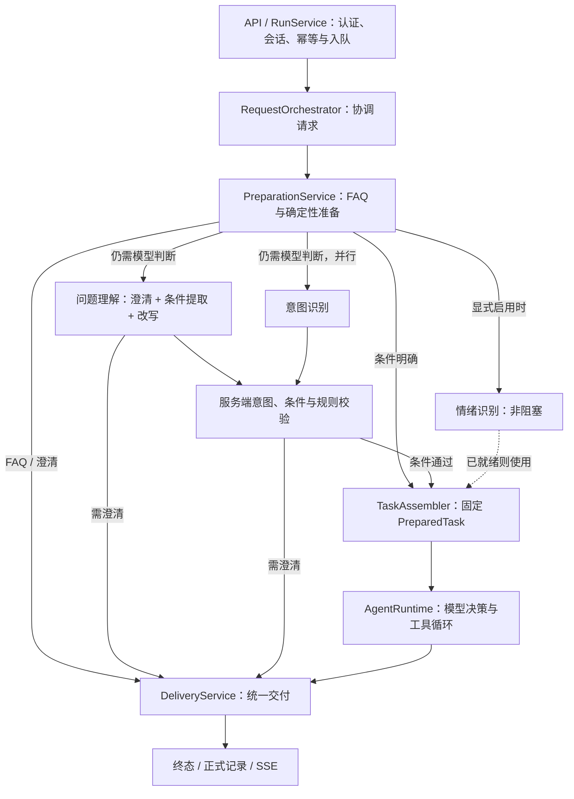

# Tianmu 运营 Agent

独立的 Java 17 / Spring Boot 服务，负责问题准备、受控执行与证据交付。

[项目首页](../README.md) · [部署说明](../docs/DEPLOYMENT.md) · [API 契约](docs/接口契约.md) · [贡献指南](../CONTRIBUTING.md)

## 开发启动

从仓库根目录执行：

```sh
mvn -B -f tianmu-agent/pom.xml verify
java -jar tianmu-agent/target/operations-agent-0.7.0-SNAPSHOT.jar
```

默认 `demo` 模式监听 `127.0.0.1:8201`，无需 Key 和中间件。请求示例见[快速开始](../README.md#快速开始)。在本模块目录也可执行 `mvn test` 或 `mvn spring-boot:run`。

## 分层与依赖



| 目录 | 职责与约束 |
| --- | --- |
| `api/` | HTTP / SSE，接口与鉴权接入 |
| `preparation/` | FAQ 优先；确定性规则先检查，明确任务直接准备，其余请求并行理解/意图识别，情绪识别可选 |
| `application/` | 任务组装、受限历史视图、统一交付 |
| `runtime/` | 请求编排、循环、状态与调度；`control/` 负责超时、取消和终态竞争 |
| `harness/` | Hook、Transform 与 Trace |
| `tool/` | 工具注册、参数与范围校验、受控执行 |
| `skill/`、`prompt/` | 资源 Catalog、版本与快照 |
| `access/`、`query/`、`model/` | 身份、业务查询与模型端口 |
| `adapters/`、`demo/` | 外部系统适配与本地模拟实现 |
| `core/`、`resource/` | 共享契约与有界资源读取 |

默认 `agent.preparation.deterministic-routing=true`：规则可明确解析的指标、视频内容和弹幕报告任务跳过模型识别，缺失或非法必需条件直接澄清。其余请求仍使用模型理解与意图识别；候选条件必须匹配服务端解析。`emotion-enabled=false` 默认关闭情绪旁路，启用时只取已就绪结果。所有实际模型调用均计入总预算，模型输出不授予权限。显式使用旧版四参数及其简化 `PreparationPolicy` 构造器时保留模型优先行为，方便已有嵌入调用兼容；Spring 使用完整配置构造器。

准备结果保存服务端解析的 specification，`TaskAssembler` 复用它并固定资源版本与按任务筛选的工具上限。持久化 JSON 保留原有 `type/conditions/provenance`，Java 侧使用类型化条件；新增可选的 preparation.specification，旧记录缺失时仍可读取。视频播放范围支持秒数区间或 mm:ss 区间，显式区间最长120秒；工具和返回证据都不能突破用户指定范围，允许在范围内进一步细查。未识别任务默认不授予工具。

业务 SQL 位于根工程的 `agentbridge/`，模型协议位于模型适配器。模型返回决策，Runtime 执行工具；工具不能直接控制终态或发送 SSE。

## 新增能力放在哪里

### 作者入口与评论读取（第一轮）

视频页仅向登录作者展示运营助手；独立 `/agent?videoId=…` 入口先调用 `GET /api/agent/videos/{videoId}/access` 校验当前视频权限。页面显隐不授予权限，业务桥接查询继续校验当前登录用户与视频归属。

评论分析复用现有准备、执行循环、证据持久化和视频理解，新增 `comment-analysis` Skill 与一个只读工具 `query_video_comments`。支持“分析这个视频过去七天的评论”，未指定区间沿用过去七天规则。第一次读取完整快照，后续分页固定同一证据与区间；保留相同文字的不同评论和直接父子关系。区间外父评论只提供上下文，作者发言单列。未读完全部分页时，服务端禁止交付完整分析。

最多读取5000条记录（含上下文），向缺失的父评论追溯最多64轮；超限明确失败，不降级抽样。数据通过原有私有证据链保存，无新数据库表或依赖。智能评论和智能弹幕的草稿编辑与作者确认发送尚未接通。

### 联合观众反馈报告

“生成观众反馈报告”或“分析弹幕和评论”准备为 `audience.report`，默认过去七天。`audience-report` Skill 只暴露三个业务工具：`query_audience`、`analyze_video_content`、`create_danmaku_report`。旧纯弹幕 Skill 与工具名保留兼容。

`query_audience` 通过现有业务桥接读库池，在一个短暂的 REPEATABLE READ 事务中复用弹幕与评论读取，并查询跨来源去重的观众账号。不能把两个独立连接上的读取时间相同当作同一快照；模型分析在数据库事务结束后执行。作者发言单列；重复弹幕按原文、作者身份与播放区段归并，评论保留独立身份及完整必要的父评论语境。

报告先逐批完整分类，再进入 `MERGE_TOPICS` 全局合并阶段。分类允许逐步发现 T1..T100 主题，最终合并必须覆盖所有主题，不能丢弃少数意见；合并规范只在该阶段按需加载。已处理批次从后续模型上下文释放，原文、引用及分类检查点仍保存在私有证据中。检查点支持重建执行状态；当前进程重启时仍沿用 `RUNNER_LOST` 终止策略，尚未实现后台作业自动续跑。

交付前核对所有来源原文的唯一归属和权重，生成 v2.0 报告 JSON 后渲染 HTML。页面展示弹幕、评论及作者数量、跨来源去重观众数，前六个观众主题优先展示，其余可展开。原话全局去重并标记来源，评论可展开父评论上下文；发送时间趋势与弹幕播放位置分布分别展示。默认必须有视频内容证据，只有作者明确要求不读视频时可省略。

这一版仍使用有界快照与串行模型循环：联合分析最多5000个原文单位，另受上下文、时间及调用预算约束；超限明确失败，不能声称支持百万互动。可恢复并行分区、增量聚类与热门视频压测是下一阶段，不通过调高循环上限冒充已完成扩容。

以下资源路径均相对于 `src/main/resources/`：

| 扩展 | 位置 / 接口 |
| --- | --- |
| Skill | `skills/<name>/SKILL.md` + `skill.json` |
| Tool | 实现 `AgentTool` 并注册 Bean；在 `tools/<name>/tool.json` 声明描述与 Schema |
| Prompt | `prompts/` 正文 + `index.json` 中的 ID / 版本 |
| FAQ | `faq/`；更换来源实现 `FaqPort` |
| 业务条件 | `QueryReadinessPolicy` / `TaskSpecificationResolver` |
| 模型 | `ModelPort` / `PreparationModelPort`，落实截止时间与取消 |
| 治理 | `AgentHook` / `TransformHook<T>` |
| 存储与导出 | 仓储端口、`ObjectStore` / `TraceSink` |

Skill 通过 `read_skill` 激活业务工具。`ToolContext` 仅提供必要宿主能力，框架校验参数、权限与固定任务条件。资源启动时校验并形成快照，当前修改后需要重新构建和启动。

Hook 分为观察与执行前拦截：Observer 失败隔离，Gate 失败关闭。Transform 按类型串联载荷，逐次检查不变量。Java 插件属于可信代码，不是隔离沙箱。

完整示例见[工程目录与扩展规范](docs/工程目录与扩展规范.md)；治理契约见 [Trace / Hook](docs/Harness-Trace与Hook设计.md)与[变换链](docs/Hook变换链设计.md)。

## 数据与恢复约定

- MySQL 是正式记录的权威来源，终态及关联交付记录在同一事务提交。
- Redis 保存可重建的授权历史视图；persistent的完整结果与HTML报告默认放在既有MinIO的私有bucket，复用TIANMU_MINIO_*配置。
- Trace 使用独立的本地文件 Outbox，异步投递 JSONL / Kafka；与存储 Outbox 分开。
- 持久化仅支持单写实例。重启可查询已完成任务、恢复符合条件的排队任务；在执行任务结束为 `RUNNER_LOST`。
- 当前业务指标是指定日期内已入库且仍保留的弹幕数，不代表完整发送总量。
- 视频就是弹幕房间，复用已有 videoId、权限、播放器和弹幕表，不引入独立直播系统。未指定时间时按请求提交时刻向前取7天；显式区间最长30天，统一北京时间、左闭右开。
- 报告结合视频采样内容解释弹幕话题，列出改进建议和真实弹幕例子。总量、用户数、时间趋势和排行由 SQL 计算；模型只分类与解释。视频关联仅限实际采样时间点，不能据此证明因果或连续动作。
- 新报告完整读取所选区间的全部原文，同文合并计数但不截取文本、不按频次抽样。Skill 只协调三个业务工具：查询弹幕、理解视频、生成报告。报告工具每次接收最多80组/12000字符的分类，保存草稿并返回下一批；全部原文归类后才交付 HTML，工具内部不调用模型。分类成员与展示例子分开，不能通过少数引用冒充完整分类。
- 报告先组装版本化 `CreatorReportDocument` JSON，再由固定 HTML 模板生成；同一 JSON 随工具结果保留在私有 Trace 中。正文先给结论，后给话题、相关画面、去重原话和具体建议；整份报告不重复引用相同或高度近似的原话。展示例子去重不改变分析或统计数量。
- 两个趋势图使用内嵌 SVG 折线图，播放位置的零弹幕区间补零，避免跨空档连线造成误读。合成数据标识保留在报告 JSON 元数据中，不在 HTML 正文显示。
- 单次完整读取目前有5000组原文及4MiB响应上限。超限、超时、预算耗尽或归类缺失时明确失败，不回退成抽样结果。普通任务保留6轮上限，报告可在既有模型次数预算内使用最多32轮；模型预算与请求截止时间仍然生效。旧演示/历史样本格式仅作为兼容路径，新业务报告不使用它。
- 互动排行按活跃天数、不同文本数、发送量排序；标识来自现有弹幕用户字段，不证明关注关系或身份真实性。播放位置缺失、越界或视频时长未知时列为未知位置。
- 房间汇总由用户点击开启，前端每15秒读取，服务端每个用户/视频/区间最多每30秒刷新，共用现有线程池、Caffeine 和模型预算。完整文本较多时分批处理，首次汇总可能超过30秒；最多12次模型调用、120秒与131072 token预算，失败保留上次成功摘要并标明时间。摘要缓存最多100项、闲置15分钟过期，最多4个刷新任务；服务重启后从 SQL 重建，不承诺持久化实时摘要历史。
- 模型不可用时仍展示准确统计；摘要失败时明确保留上次摘要时间。`demo` 的旧模拟数据不提供完整房间话题能力；真实语义质量仍需人工验收。

## 验证与进一步阅读

从仓库根目录执行：

```sh
mvn -B -f tianmu-agent/pom.xml verify
python scripts/smoke_demo.py --jar tianmu-agent/target/operations-agent-0.7.0-SNAPSHOT.jar
git diff --check
```

普通测试无需模型 Key；真实存储测试需隔离 MySQL / Redis，并显式启用 `AGENT_STORAGE_IT=true`。CI 不调用收费模型。

- [入口与并行预处理](docs/统一入口与并行预处理.md)：顺序、汇合、降级和取消。
- [持久化存储接入](docs/持久化存储接入.md)：配置、事务、恢复与删除。
- [P0 业务接入](docs/P0业务接入.md)：身份、授权、指标口径和 SQL 对账。
- [弹幕分析报告](docs/弹幕分析报告.md)：统一videoId、Tool/Skill、统计与样例口径、私有HTML交付。
- [部署说明](../docs/DEPLOYMENT.md)：profiles 与环境变量。
- [路线图](../docs/ROADMAP.md)：尚未实现的能力与后续方向。

模型调用次数与 Token 预留、结算及配置见[模型调用预算](docs/模型调用预算.md)。默认每任务最多16次模型调用和64,000 Token；文本、视觉与转写共享额度。相同作者、互动快照和视频事实可在一小时内复用分类进度，MySQL 模式跨进程持久化并使用租约避免重复分类；货币费用结算尚未实现。

作者私有 Q&A 默认在5个独立会话提供相同稳定回答、答案占比至少90%后自动加入；内置 FAQ 优先，已加入内容直接回答且不消耗模型调用。作者可在“常见问答”查看积累、停用或重新学习；状态与失效边界见[缓存与 Q&A 准入](docs/缓存与Q&A准入.md)。

文本模型的历史裁剪、重复 Schema 消除与发送前大小限制见[上下文预算](docs/上下文预算.md)。必要证据超限时明确失败，避免丢失口径或证据引用。

视频模型接口拆分、同请求在途合并、独立取消与缓存并发说明见[视频分析并发与缓存](docs/视频分析并发与缓存.md)。

本轮执行上下文、Spring 执行器、Caffeine、存储端口、OTLP 和前端职责整理，以及 SDK 保留决策，见[架构边界与组件选型](docs/架构边界与组件选型.md)。

后续以创作者复盘为主线，按[产品与技术迭代方案](docs/产品与技术迭代方案.md)推进；首批[24条验收场景](eval/scenarios.json)为待绑定素材/标注的清单，不代表真实模型评测结果。
