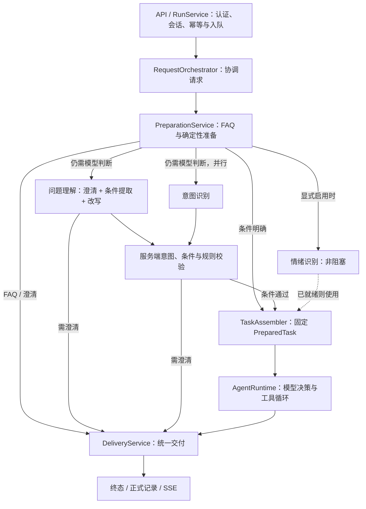

# Tianmu 运营 Agent

独立的 Java 17 / Spring Boot 服务，负责问题准备、受控执行与证据交付。

[项目首页](../README.md) · [部署说明](../docs/DEPLOYMENT.md) · [API 契约](docs/接口契约.md) · [贡献指南](../CONTRIBUTING.md)

## 开发启动

从仓库根目录执行：

```sh
mvn -B -f tianmu-agent/pom.xml verify
java -jar tianmu-agent/target/operations-agent-0.7.0-SNAPSHOT.jar
```

默认 `demo` 模式监听 `127.0.0.1:8201`，无需 Key 和中间件。请求示例见[快速开始](../README.md#快速开始)。在本模块目录也可执行 `mvn test` 或 `mvn spring-boot:run`。

## 分层与依赖



| 目录 | 职责与约束 |
| --- | --- |
| `api/` | HTTP / SSE，接口与鉴权接入 |
| `preparation/` | FAQ 优先；确定性规则先检查，明确任务直接准备，其余请求并行理解/意图识别，情绪识别可选 |
| `application/` | 任务组装、受限历史视图、统一交付 |
| `runtime/` | 请求编排、循环、状态与调度；`control/` 负责超时、取消和终态竞争 |
| `harness/` | Hook、Transform 与 Trace |
| `tool/` | 工具注册、参数与范围校验、受控执行 |
| `skill/`、`prompt/` | 资源 Catalog、版本与快照 |
| `access/`、`query/`、`model/` | 身份、业务查询与模型端口 |
| `adapters/`、`demo/` | 外部系统适配与本地模拟实现 |
| `core/`、`resource/` | 共享契约与有界资源读取 |

默认 `agent.preparation.deterministic-routing=true`：规则可明确解析的指标、视频内容和弹幕报告任务跳过模型识别，缺失或非法必需条件直接澄清。其余请求仍使用模型理解与意图识别；候选条件必须匹配服务端解析。`emotion-enabled=false` 默认关闭情绪旁路，启用时只取已就绪结果。所有实际模型调用均计入总预算，模型输出不授予权限。显式使用旧版四参数及其简化 `PreparationPolicy` 构造器时保留模型优先行为，方便已有嵌入调用兼容；Spring 使用完整配置构造器。

准备结果保存服务端解析的 specification，`TaskAssembler` 复用它并固定资源版本与按任务筛选的工具上限。持久化 JSON 保留原有 `type/conditions/provenance`，Java 侧使用类型化条件；新增可选的 preparation.specification，旧记录缺失时仍可读取。视频播放范围支持秒数区间或 mm:ss 区间，显式区间最长120秒；工具和返回证据都不能突破用户指定范围，允许在范围内进一步细查。未识别任务默认不授予工具。

业务 SQL 位于根工程的 `agentbridge/`，模型协议位于模型适配器。模型返回决策，Runtime 执行工具；工具不能直接控制终态或发送 SSE。

## 新增能力放在哪里

以下资源路径均相对于 `src/main/resources/`：

| 扩展 | 位置 / 接口 |
| --- | --- |
| Skill | `skills/<name>/SKILL.md` + `skill.json` |
| Tool | 实现 `AgentTool` 并注册 Bean；在 `tools/<name>/tool.json` 声明描述与 Schema |
| Prompt | `prompts/` 正文 + `index.json` 中的 ID / 版本 |
| FAQ | `faq/`；更换来源实现 `FaqPort` |
| 业务条件 | `QueryReadinessPolicy` / `TaskSpecificationResolver` |
| 模型 | `ModelPort` / `PreparationModelPort`，落实截止时间与取消 |
| 治理 | `AgentHook` / `TransformHook<T>` |
| 存储与导出 | 仓储端口、`ObjectStore` / `TraceSink` |

Skill 通过 `read_skill` 激活业务工具。`ToolContext` 仅提供必要宿主能力，框架校验参数、权限与固定任务条件。资源启动时校验并形成快照，当前修改后需要重新构建和启动。

Hook 分为观察与执行前拦截：Observer 失败隔离，Gate 失败关闭。Transform 按类型串联载荷，逐次检查不变量。Java 插件属于可信代码，不是隔离沙箱。

完整示例见[工程目录与扩展规范](docs/工程目录与扩展规范.md)；治理契约见 [Trace / Hook](docs/Harness-Trace与Hook设计.md)与[变换链](docs/Hook变换链设计.md)。

## 数据与恢复约定

- MySQL 是正式记录的权威来源，终态及关联交付记录在同一事务提交。
- Redis 保存可重建的授权历史视图；persistent的完整结果与HTML报告默认放在既有MinIO的私有bucket，复用TIANMU_MINIO_*配置。
- Trace 使用独立的本地文件 Outbox，异步投递 JSONL / Kafka；与存储 Outbox 分开。
- 持久化仅支持单写实例。重启可查询已完成任务、恢复符合条件的排队任务；在执行任务结束为 `RUNNER_LOST`。
- 当前业务指标是指定日期内已入库且仍保留的弹幕数，不代表完整发送总量。
- 弹幕分析报告按相同videoId和权限读取准确统计与最多48条片段；视频和直播间使用同一套弹幕能力。

## 验证与进一步阅读

从仓库根目录执行：

```sh
mvn -B -f tianmu-agent/pom.xml verify
python scripts/smoke_demo.py --jar tianmu-agent/target/operations-agent-0.7.0-SNAPSHOT.jar
git diff --check
```

普通测试无需模型 Key；真实存储测试需隔离 MySQL / Redis，并显式启用 `AGENT_STORAGE_IT=true`。CI 不调用收费模型。

- [入口与并行预处理](docs/统一入口与并行预处理.md)：顺序、汇合、降级和取消。
- [持久化存储接入](docs/持久化存储接入.md)：配置、事务、恢复与删除。
- [P0 业务接入](docs/P0业务接入.md)：身份、授权、指标口径和 SQL 对账。
- [弹幕分析报告](docs/弹幕分析报告.md)：统一videoId、Tool/Skill、统计与样例口径、私有HTML交付。
- [部署说明](../docs/DEPLOYMENT.md)：profiles 与环境变量。
- [路线图](../docs/ROADMAP.md)：尚未实现的能力与后续方向。

模型调用次数与 Token 预留、结算及配置见[模型调用预算](docs/模型调用预算.md)。Token 上限默认关闭；文本、视觉与转写共享任务额度，货币费用结算尚未实现。

文本模型的历史裁剪、重复 Schema 消除与发送前大小限制见[上下文预算](docs/上下文预算.md)。必要证据超限时明确失败，避免丢失口径或证据引用。

视频模型接口拆分、同请求在途合并、独立取消与缓存并发说明见[视频分析并发与缓存](docs/视频分析并发与缓存.md)。

本轮执行上下文、Spring 执行器、Caffeine、存储端口、OTLP 和前端职责整理，以及 SDK 保留决策，见[架构边界与组件选型](docs/架构边界与组件选型.md)。

后续以创作者复盘为主线，按[产品与技术迭代方案](docs/产品与技术迭代方案.md)推进；首批[24条验收场景](eval/scenarios.json)为待绑定素材/标注的清单，不代表真实模型评测结果。
