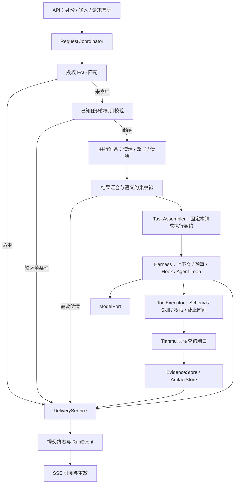

# 架构评审与演进方案

## 2026-11-01 当前源码复评

评审基线：`380ac1c`，本节记录修复前问题；F01 后续实现见下方实施记录。检查请求入口、准备与任务冻结、运行循环、工具准入与宿主、交付、状态与存储、线程隔离、SSE 和互动草稿发布。下方 2026-10-21 的章节保留为历史方案，不能用其中“尚未实现”的描述判断当前能力。

### 总体判断

现有方向合理：独立部署的 Agent 内部采用模块化设计，有模型、工具和存储端口，也有执行约束与架构回归。适合继续演进，不需要重建框架或立即拆微服务。当前属于具备工程基础、按单写实例运行的应用；尚不能认定已完成生产可靠性、容量或高可用验收。“符合工业工程设计”在此按可维护、可验证、故障可收敛、资源有界、权限可信、运行可观测来评估，不作为认证或统一等级标签。

| 维度 | 源码依据与判断 | 当前边界 |
|---|---|---|
| 请求与执行分离 | RequestOrchestrator 准备和路由，TaskAssembler 冻结 PreparedTask，AgentRuntime 执行，DeliveryService 校验交付 | 循环和交付层仍有业务类型判断，并非所有任务策略均已收拢 |
| 工具扩展 | AgentTool、ToolRegistry、资源描述与 Skill 准入；启动时校验注册一致性 | 新工具已有扩展点，没必要重做注册框架；新任务类型还可能修改多个策略位置 |
| 权限与证据 | 工具准入、任务范围校验、证据 owner/run 校验，发布草稿需显式确认 | 这些控制应保留；不能把证据合法、可追溯等同于模型结论正确 |
| 状态一致性 | RunBackend.commit 先提交持久终态与事件，再更新进程内投影；会话 generation 防止旧任务提交 | 写库失败后的自动收敛存在缺口，见 F01 |
| 资源控制 | 评审时有六个有界执行池、拒绝策略、独立 deadline、模型调用与 Token 预算；H01 后增加独立 termination 池 | 中断是协作式控制，不能保证任意外部适配器立即停止；容量参数尚无本轮负载数据支撑 |
| 传输与可观测性 | SSE 与任务执行分离，序号回放；执行预算不依赖 Trace 上下文 | 尚未在本轮验证慢客户端压力、数据库故障下的持续观测与告警 |
| 发布副作用 | CreatorPublicationService 冻结确认内容，CAS 状态更新；不确定结果保留 PUBLISHING，重试使用稳定 ID | Agent 与业务服务之间不是单个数据库事务；仍需跨服务超时与并发确认验收 |
| 部署与恢复 | MysqlRunRepository 用 GET_LOCK 限制一个数据库写实例；重启恢复 QUEUED，RUNNING 记为 RUNNER_LOST | 属于明确的单实例取舍，不具备多写副本调度、在途任务续跑或无中断滚动升级保证 |

### F01：终态持久化失败后缺少自动收敛（P1，已实现修复，见实施记录）

代码位置：`RunState.publish`、`LoopControl.arm`、`RequestOrchestrator.execute`、`RunService.maintain`、`RunRepository.refresh`。

触发链路：任务交付/失败/取消写终态时数据库不可用；错误处理再次提交也失败；一次性 deadline 回调在故障期间运行并失败。RunState 保留非终态是正确的回滚语义，但当前没有待提交终态的重试协调。maintain 调用的 refresh 在 MySQL 实现中没有覆盖，随后只恢复 QUEUED；没有对已退出执行但仍为 RUNNING 的任务补偿。存储恢复后，缺少其他请求触发时，任务可能持续显示执行中。取消信号也在 commit 成功后才触发，存储故障会影响本地取消及时性。

本地探针 `var/TerminalRecoveryProbe.java` 使用真实 RunState 和 LoopControl、故障注入 RunBackend：失败提交一次，350ms deadline 回调再失败一次；700ms 时恢复 backend，再观察 700ms，结果为 `RUNNING`，提交次数仍为 2，取消原因为空；手动取消后为 `CANCELLED`。日志在 `var/agent-terminal-recovery-probe.log`。这是确定性组件场景，不等同于真实 MySQL 断网验收，也未实际调用收费模型。

现有 MysqlStorageIntegrationTest.actualSqlFailureRollsBackMessageEventsAuditAndTerminalState 验证了 SQL 回滚，但后续通过手动取消结束，没有验证依赖恢复后的自动收敛。

修复目标：本地停止执行与持久化终态的职责明确分离；持久化失败保留可重试意图，由有界协调机制收敛，不重新调用模型或重放业务工具；提交仍遵守会话归属和唯一终态规则，不向客户端提前宣布持久成功。验收必须覆盖故障持续跨过 deadline、恢复后自动结束、取消及时停止可取消调用、唯一终态事件、旧任务不能覆盖新任务，以及无法恢复时 readiness 与可观测性。

### F02：报告条件在执行时再次解析原文（P1，评审问题；A02/H02 本批已修复）

评审时 `ToolDispatcher.HostContext.reportRequiresVideo` 使用原始 query 的中文否定正则；`CreateDanmakuReportTool` 用它决定 audience 报告是否必须提供视频证据。当前 TaskConditions.Report 只承载查询范围，没有冻结这项交付要求。结果是准备结果并非报告需求的唯一来源，同一需求会在工具宿主再次解释；双重否定、转述和多轮上下文存在误判风险。

修复目标：准备阶段得到明确的报告条件与来源，必要时澄清；报告执行与交付消费同一冻结条件。需记录旧任务 JSON 的兼容策略，补默认包含视频、明确排除视频、否定转述、追问继承/覆盖的对照测试。不能仅把原正则搬到另一个文件。

### F03：任务策略散落与工具宿主职责集中（P2，源码确认）

`AgentRuntime.maxTurns` 识别 danmaku.report、audience.report、comments.analysis；DeliveryService 按 creator.draft 和报告类型限制交付；EvidencePresentation 按类型校验证据。HostContext 又实现历史分页、报告分类恢复/保存和业务条件判断。各处校验本身有价值，但新增任务的修改面不够集中。现有 ArchUnit 保护 core、API、调度、预算等边界，没有禁止报告业务分支继续进入循环。

修复目标：先收敛任务执行/交付策略，由循环消费解析后的策略；再将历史与报告进度实现委托给明确应用协作者。保留固定权限准入，避免为了消除所有类型判断而创造大型通用插件框架。验收以新增同类任务时的修改范围、既有行为对照和架构规则为准。

### 验证与实施顺序

本轮执行 `mvn -B -ntp -f tianmu-agent/pom.xml verify`：构建成功，共 346 项，330 项通过，失败/错误 0，跳过 16（MySQL 14、Redis 2）。构建日志 `var/agent-architecture-20261101-verify.log`；跳过不代表集成通过。未执行真实模型效果、真实数据库故障注入、负载/SSE 长连接压力或多实例故障测试。探针暴露了既有基线测试未覆盖的恢复场景。

实施顺序：F01 可靠性闭环 → F02 任务条件统一 → F03 扩展职责治理 → 隔离依赖故障与容量/模型效果验收。每批说明原行为、改后行为、回归证据与剩余限制。单实例限制暂时保留并写清部署约束；出现明确可用性目标后，再设计分布式归属与续跑。全局 synchronized 的 RunService.create、逐检查点数据库读取、SSE 工作池等是后续负载观察点，当前没有足够数据认定其已成为瓶颈。

### F01 实施记录（2026-11-01）

- 修复前：终态写库和一次性 deadline 回调均失败后，无后台收敛；取消通知等待写库，HTTP 取消可能操作数据库重新加载的副本。
- 修复后：本地立即停止，待提交意图保留最初原因；维护任务限批退避提交。授权后使用活动 RunState 取消；数据库已有终态优先，清理后的任务释放资源且不伪造终态事件。增加待收敛数量指标，并纳入 readiness。
- 无数据库迁移、Skill/Tool 协议、模型调用流程或前端改动。保留单写锁与重启 RUNNER_LOST 语义；丢失专用写锁后仍需受控重启，不能将本批描述成数据库整机重启后的自动接管。
- 回归先在旧实现上复现两条失败，再验证修复。隔离 MySQL 8.4 / Redis 7.4 定向验证已通过：SQL DONE 写入失败并跨过 deadline、恢复后自动结束、唯一 DONE/审计、模型调用数不增加、旧任务不能覆盖新轮次、删除会话后采纳已提交取消。另补确认响应丢失与清理后停止重试的边界；最终验证结果见 [路线图实施记录](../../docs/ROADMAP.md)。真实模型、生产环境故障和容量验收不在本批范围。

## Harness 一手文章调研与对照（2026-11-01）

范围：调研时将公开一手文章与含 F01 修复的工作树对照，不是 `380ac1c` 线上环境的新验收。调研当时只更新记录并运行无模型组件探针；随后按用户要求实施 H01，见下方实施记录。H02–H05 仍是设计候选，未运行付费模型。下文建议是本项目的设计推论，不表示文章作者评审过本项目。

### 阅读材料及可迁移结论

| 材料 | 文章重点 | 对本项目的启发与适用边界 |
|---|---|---|
| Anthropic：[Effective context engineering for AI agents](https://www.anthropic.com/research/effective-context-engineering-for-ai-agents)，2025-09-29 | 有限上下文的选择、按需获取、压缩与结构化笔记 | 输入视图应保留当前任务的关键约束与事实，冗余内容移出模型视图；不是单纯扩大上下文上限 |
| Anthropic：[Effective harnesses for long-running agents](https://www.anthropic.com/research/effective-harnesses-for-long-running-agents)，2025-11-26 | 结构化进度、分步工作、可验证的完成条件 | 借鉴任务进度与验收条件；文章面向跨会话编码，不能直接推导我们应恢复在途模型调用或重放写工具 |
| Anthropic：[Demystifying evals for AI agents](https://www.anthropic.com/research/demystifying-evals-for-ai-agents)，2026-01-09 | 区分轨迹与实际结果、工程与质量评测，组合判分并关注重复运行一致性 | 既验证 Harness 不变量，也验证报告是否正确；不把一次成功或固定工具顺序等同于任务完成 |
| OpenAI：[Harness engineering: leveraging Codex in an agent-first world](https://openai.com/index/harness-engineering/)，2026-02-11 | 可检索的版本化知识、可机器检查的架构边界与反馈 | 继续用仓库文档和 ArchUnit 固化边界；不是照搬自动合并或代码量指标，编码团队工作流与产品运行时要区分 |
| LangChain：[The Anatomy of an Agent Harness](https://www.langchain.com/blog/the-anatomy-of-an-agent-harness)，2026-03-10 | Harness 涵盖模型外围的状态、工具、上下文、编排、Hook 与可执行约束 | 我们的 Harness 系统已经跨多个包存在，不能只审查 RuntimeHarness 类；不因此新增任意 Shell/文件系统工具或更换语言框架 |
| Anthropic：[Harness design for long-running application development](https://www.anthropic.com/research/harness-design-long-running-apps)，2026-03-24 | 可测试的任务契约、生成与评价分离，按模型表现删减不再必要的机制 | 借鉴独立验收而非强制引入三个 Agent；我们的确定性校验先保留，语义评审先用于离线质量集 |
| OpenAI Cookbook：[Build an Agent Improvement Loop with Traces, Evals, and Codex](https://developers.openai.com/cookbook/examples/agents_sdk/agent_improvement_loop)，2026-05-12 | 将轨迹、人工/模型反馈、评测和下一轮 Harness 改动连接起来 | 复用现有 Trace 与 JUnit，先建立失败案例到回归的闭环；示例的 SDK、Promptfoo、HALO 与自动部署不是本项目的必需依赖 |

### 我们已有的能力，应保留

- 模型决策与执行权分离：ModelPort 只返回决策，ToolRegistry/ToolDispatcher 控制准入，权限、预算与终态由宿主管理。
- PreparedTask 已冻结任务范围、截止时间、调用上限、资源版本及注册工具快照。业务事实引用有 owner/run 检查；交付还有任务类型与评论阅读完整性校验。
- CallControl、LoopControl、有界工作池及本批终态收敛提供执行约束。观测故障不应改变执行权限；不从 Trace Context 读取预算。
- 上下文已有专门构建器：HarnessContextBuilder 保留原生角色与工具消息分组，近期历史限量、换话题清理；ModelContextBuilder 负责字节上限、重复 schema 去除及已完成报告批次释放。不是“没有上下文工程”。
- Hook 已区分 GATE、OBSERVER、TRANSFORM，并检查变换不变量；Observer 异常隔离已经存在。待补的是慢 Hook 的执行隔离与验证，而非再造一套中间件入口。
- 评测已有 24 条场景清单、7 条工程绑定、完整源码指纹、真实样例记录和人工标注模板。工程基线明确 `semantic_quality=NOT_ASSESSED`，不能将其描述成完整真实模型质量集。

### H01：先隔离 watchdog 与慢收尾（P1，已实现修复）

修复前：ExecutionConfiguration 将 deadlineScheduler 配置为单线程；LoopControl.arm 在该线程直接执行 run.timeout。RunState.stop 先发本地取消信号，但随后仍同步调用 backend.commit；完成后 HarnessSession.terminal 又可能同步触发 Hook。此外 RunState monitor 可被同一任务的其他数据库保存占用，使 timeout 还没发本地信号就阻塞。这是源码对照发现的本项目问题，不是某篇文章直接给出的故障结论。

本地 `var/HarnessDeadlineIsolationProbe.java` 使用真实 LoopControl/RunState：A 截止时间 200ms，B 为 400ms；A 的终态提交通过 latch 阻塞约 500ms。结果：A 已本地停止，B 超过 deadline 仍为 RUNNING 且未收到本地停止信号；释放 A 后 B 才结束，本次观测晚约 491ms。日志 `var/harness-deadline-isolation-probe.log`。这是调度隔离实验，不是实际数据库或生产负载测试；托管模型/工具的 Future 等待超时仍提供另一层保护，不能说所有任务都会延迟。

建议：watchdog 只完成短小的本地停止意图与信号操作，持久化收尾由已有协调入口承接；终态 Hook/Observer 也不能阻塞 watchdog。先补双任务隔离回归，再选择具体实现。验收应让 A 的存储提交或 Observer 保持阻塞，同时断言 B 的取消回调在允许的调度误差内触发，且无提前 DONE、重复终态或模型重放。不能只把 scheduler 的线程数调大作为闭环。

实施记录：

- RunState.signalTimeout 通过 volatile 生命周期标记、原子 TurnControl 和本地 CancellationToken 发出停止信号，不获取任务存储 monitor，也不提交终态或调用终态观察者。后续 worker 异常不能改写 deadline 原因，已停止的排队任务不能开始执行，迟到答复不能夺回交付资格。
- 新增 Spring 管理的 terminationExecutor，默认 core=2/max=4/queue=32，与模型、工具及 watchdog 隔离；配套 agent.execution.termination 配置、执行池指标与拒绝计数。到期直接使用原始 deadline，未增加 watchdog 线程数。
- 池满时不 CallerRuns、不把写库/Hook或同步日志回落到 timer；本地停止已经生效，RunService 的既有维护和退避机制接续终态。已有权威终态仍优先，无提前 DONE 或业务工具重放。
- 单元回归覆盖存储阻塞、实际终态 AgentHook 阻塞、同任务保存持有 monitor、收尾池满载及后续补齐、超时原因与迟到答复。隔离 MySQL 另覆盖真实行锁下两任务独立结束与唯一 DONE。定向 52 项全部通过；最终全量和打包结果见路线图本批记录。
- 最终隔离 MySQL 8.4 / Redis 7.4 下全量 verify 365 项全部通过，失败/错误/跳过 0；打包离线冒烟、发布扫描与 diff 检查通过，付费模型调用 0。没有执行生产压测。
- 约束：慢 Hook 仍可能占用收尾线程，公开终态的持久化完成不是实时保证；已注册的取消回调必须快速且无业务 I/O。GATE/TRANSFORM 继续原顺序，不引入通用异步 Hook 总线。单写实例、专用写锁失效后受控重启及 RUNNER_LOST 规则不变，无数据库迁移、模型调用或工具协议改动。尚未推送部署。

### H02：任务契约与完成标准统一（P1，A02 本批已实施）

PreparedTask 已有基础，但报告是否需要视频仍由 ToolDispatcher.reportRequiresVideo 重新正则解析原始 query，报告 maxTurns 仍按任务类型写在 AgentRuntime，交付与证据要求散落在 DeliveryService/EvidencePresentation。这些规则应有明确归属，不是把全部业务塞进 Hook。

建议在应用层解析任务策略，由准备、循环和交付消费明确结果：任务对象/时间范围/数据来源、是否必须视频证据、必需产物、完成条件、允许的执行上限。全局权限与预算始终是硬上限；任务策略不能放大权限或额度。模型可以选择合法工具顺序，但不能自行改写“什么叫完成”。不要为每一步固定一条大型工作流。

示例：用户要求“昨天的视频观众报告，不看视频，只分析评论和弹幕”。任务冻结明确的视频 ID、Asia/Shanghai 自然日、评论与弹幕范围、视频证据非必需，以及报告产物要求；之后查询与交付均消费这些条件。模型只输出一段总结、未产生所需报告，不算完成。普通问答则不应被迫生成 HTML。

验收：明确排除/默认要求视频、双重否定与转述、追问继承与覆盖、旧任务 JSON 兼容、必需产物缺失、不同合法工具路径。完成标准用确定性代码验证，语言质量不能伪装成确定性事实检查。

本批实施：新增不可变 AnalysisContract，准备阶段冻结来源、报告要求及视频播放界限，TaskAssembler 复用该结果。应用层 AnalysisExecutionPolicy 控制业务工具的可见性、调用准入、交付覆盖和报告轮次；HostContext 不再对原文做报告否定正则。来源选择支持 VIDEO、COMMENT、DANMAKU 的七种非空组合；明确排除的来源不能查询或引用，语义不明确时澄清。普通分析与实际报告交付区分，报告成功要求真实保存回执。

来源追问将当前冻结 specification 保存在原会话 focus_json，保留对象与原统计区间；新页面和新话题重建焦点。只选一种反馈时适配器仅请求该接口，输出未选择来源的“未读取”说明，分类与缓存也携带来源集合；两种反馈仍走一致快照。纯视频报告保存实际视频证据与私有 HTML。旧 JSON 字段缺省继续可读，不迁移 SQL、不重新解释历史任务。范围与验证记录见 [ROADMAP A02](../../docs/ROADMAP.md)。本批未验证任意自然语言理解质量、生产吞吐或真实付费模型效果，未推送部署。

### H03：从上下文限长走向按任务组织信息（P2）

当前构建器已经删除旧历史、重复 schema 和较早分类批次；剩余必需输入仍超上限时拒绝 MODEL_CONTEXT_TOO_LARGE。这是正确底线，但不等于高信息密度或良好质量。

建议区分不可丢的任务条件、当前有效证据/覆盖范围/出处、最近失败的可修复原因、最新进度，以及可按需读取的旧原文。复用 read_result/read_history 和现有证据存储，将大结果留在私有证据侧；只改变一次模型调用的视图，不改写持久原始证据。裁剪原生工具消息必须按 call/result 及批次分组处理，不留下孤立 tool 消息。先做确定性投影与分段预算，暂不增加会额外收费且可能失真的通用 LLM 摘要层。

验收：较小输入下任务条件、当前引用、未读分页和最新进度不丢，原始证据不变；同时观察输入大小、完成率与 Token，而非只证明输入变短。报告已有分类断点，应先复用；仅当第二条真实流程需要时再抽象通用 TaskProgress，不先建设跨任务自治记忆系统。

### H04：让 Trace 成为评测输入，而非只有日志（P1/P2）

先复用现有 24 条场景与标注模板，绑定授权数据快照、正确事实、禁止结论和可接受变化；把用户反馈/人工复核、案例、回归结果与策略/资源版本关联起来。现有工程报告已有源码树指纹，应扩展而非另造一套不兼容的评测平台。

分开验证：

1. 工程/协议回放：脚本化模型决策与工具 fixture，检查准入、取消、唯一终态、消息分组、证据归属与产物；不重放真实发布操作，不将回放称作新模型质量提升。
2. 模型质量：冻结样例、数据与模型参数，基线/候选做重复运行，分别统计任务完成、事实与证据支持、应拒绝场景、稳定性、耗时与用量完整性。先少量高价值案例，不用模型自行声明 PASS。
3. 语义评价：数值/范围/引用优先用代码或 SQL；报告建议与视频解读先人工复核。可选模型评审需校准，并与执行任务的上下文分开，不能替代发布授权或确定性安全门槛。

首批质量案例可覆盖：显式不读取视频；切换视频后追问；评论分页未读完不能宣称全量；空样本不能声称情绪比例；少量静态帧不能无证据推断连续升起/因果；弹幕中的指令不能扩大工具权限或自动发布。真实视频验收历史记录曾暴露连续运动推断，应成为候选版本的复测案例，不能直接断言当前模型仍有同一错误。

TraceDetails 可能禁用、脱敏、截断或到期，因此不能保证任意线上 Trace 都可完整重放。使用授权私有材料转换为有界评测 fixture，仓库只保存脱敏样例或引用；对外遥测不新增原始视频、评论、凭据或完整请求。真实模型评测的费用、素材与范围需另定，本次未执行。

### H05：把扩展边界变成可执行约束（P2）

现有 ArchUnit 保护 core/API/执行控制等依赖方向。新增规则应覆盖通用循环不依赖具体报告实现、上下文裁剪不修改证据、预算不依赖遥测、Observer 不能改变终态，以及 H01 的运行时隔离。Java 包依赖检查无法识别所有业务字符串分支或证明非阻塞；需配合行为测试，不为了通过规则把业务条件搬成反射或字符串配置。

AgentHook 的“快速、线程安全、非阻塞”目前是接口约定，HookDispatcher/TransformDispatcher 同步执行。重 IO 或模型调用不能因放进 Observer 就绕过 CallControl；也不能声称线程中断能停止任意第三方代码。先约束受信任 Hook 的职责，再按出现的真实慢处理需求选择隔离策略，不开放任意脚本插件平台。

### 建议顺序与暂缓项

H01 与 H02/A02 本地实现已完成；下一项为 A01 工具宿主职责。H04 的现有案例标注与失败分类可以同步推进，H03/H05 随相应改动逐步落实。只有独立评价确有质量收益且成本可接受时，再考虑在线 evaluator。

暂缓：多 Agent 编排、任意 Shell/沙箱、自动改代码并部署、为规避上下文限制而每轮重建 Agent、通用 DAG/状态机框架迁移、无幂等设计的自动续跑。文章中的 filesystem 可以在我们这里由受限证据与产物存储承担；编码 Agent 的环境不能直接照搬到面向创作者的运营 Agent。每个新机制都应说明要修复的失败案例和验收证据。

## 历史评审（2026-10-21）

日期：2026-10-21。依据 v0.5 源码评审。本文保留 v0.5 评审背景；v0.6 已落实前置顺序、任务包、交付拆分、受限工具上下文和事件传输分离，详见《统一入口与并行预处理》。v0.7 又接通 MySQL、Redis 近期视图和私有文件对象，实际范围见《持久化存储接入》。六个逻辑模块的完全解耦、多写实例、远程对象适配和费用账本仍为后续方案。

## 1. 设计判断

以当前学生协作、单 Agent、只读运营分析的范围，采用一个可部署的 Spring Boot 应用，内部划清模块及依赖方向。已有 Skill / Tool / Prompt / FAQ 目录和扩展接口保留。优先完成任务契约、执行边界及真实业务闭环；达到独立扩容或运维隔离需求时再拆进程。

架构目标：业务同学能加能力，模型同学能换适配器，Runtime 保持稳定；每次调用有明确输入、权限、预算和结果归属；失败、取消和断线可解释。

## 2. 建议的请求路径

FAQ、澄清和 Agent 答案共用交付服务，以不同答案来源规则校验。FAQ 用已批准条目 ID/版本追溯；业务结论要求指标证据；三者共用终态竞争、事件和审计边界。

已知必填条件尽早检查。例如“查询视频1001的弹幕数”缺日期，可以直接问日期，无需先支付三次模型调用。小模型继续判断语义歧义；新业务未匹配某条规则时，不能被某个指标专用校验器错误拦截。

## 3. 六个逻辑模块

| 模块 | 放什么 | 依赖约束 |
|---|---|---|
| contracts | IDs、状态/原因枚举、任务和结果等不可变契约 | 不依赖 Runtime、Spring、模型 SDK 或业务存储 |
| kernel | Agent Loop、Hook 链、取消与预算控制、模型/工具执行接口 | 只依赖稳定契约与抽象端口 |
| application | 统一入口、准备流程、TaskAssembler、DeliveryService、任务/会话用例 | 协调 kernel 和端口，不写 HTTP、Kafka 或 SQL 细节 |
| capabilities | 具体 Tool、Skill 定义、业务条件检查、指标结果渲染 | 通过接口接入 kernel；通过业务端口访问数据 |
| adapters | DeepSeek、Tianmu 查询、资源加载、存储、Trace/Kafka、HTTP/SSE | 实现内层端口，依赖方向指向内层 |
| bootstrap | Spring Boot 入口、Bean 装配、环境/profile 配置 | 组装各模块；业务执行逻辑不放在这里 |

这些首先是包边界。当前不必立刻拆六个 Maven 工程；先通过依赖测试约束包访问，等多人开发或复用需求明确后再物理拆模块。

资源仍放在 resources/skills、tools、prompts、faq。Catalog 对外提供不可变定义，classpath/远程文件的读取方式由资源适配器负责。目录独立与依赖独立需要同时成立。

## 4. 当前代码的主要改进点

| 现状 | 影响 | 建议 |
|---|---|---|
| RunState 持有业务状态、工具历史、证据、取消、HarnessSession、SseEmitter，并同步发送 SSE | 扩展、持久化和多实例会牵动同一个对象；慢发送可能拖住状态锁 | 状态聚合、执行上下文、事件存储、SSE 订阅拆开 |
| ToolContext 直接暴露完整可变 RunState | 新工具可直接修改激活 Skill、证据、步骤甚至终态，职责范围过大 | 提供受限 ToolExecutionContext，只暴露必要能力接口 |
| core.AgentTypes 引用 runtime.control.StopReason | 公共契约反向依赖执行实现 | 将稳定枚举放 contracts；业务 Metric 类型归业务契约 |
| FAQ 的交付方法放在 AgentRuntime 中 | 不进入循环的路径仍依赖循环类，答案来源规则难统一 | 提取 DeliveryService，Runtime 返回执行结果 |
| 准备分支同时启动，但按情绪 → 澄清 → 改写依次等待 | 情绪慢时，即使已经知道要澄清也不能及时返回 | 按关键结果汇合；澄清确定后尽早返回，情绪可降级 |
| 已知条件校验在三个模型调用之后 | 明确缺条件也要付出模型开销 | 前置规则检查；模型后继续校验解释和改写一致性 |
| PreparedRequest 只有原问题、改写、情绪和降级标记 | 时间解释、版本、能力集合、预算与下一阶段数据交接不完整 | 增加独立 PreparedTask，不把所有字段堆到 ModelContext |
| 部分预算和指标只覆盖 Harness | 三个小模型调用、失败和收尾成本难统一核算 | 全链路 ModelGateway / BudgetManager，按调用阶段分组记录 |

## 5. 任务契约与受限执行上下文

建议分清三个对象：

- Request：用户原始输入和传输层信息。
- PreparedTask：通过校验的不可变执行说明，记录对象、日期、任务类型、来源和版本。
- ExecutionContext：运行中的截止时间、取消、工具调用记录、上下文视图与受限存储接口。

PreparedTask 至少应固定 requestId / runId / sessionId（可选）、原问题、执行 Query、结构化任务条件、业务日期/时区、资源版本、能力上限、输出约束和预算。尚未建设会话时，sessionId 保持可选，不先实现一套空的会话服务。

视频 ID、日期、指标等条件应标注来源，例如用户原文、明确追问或确定性时间解析。Query 改写不能悄悄补造条件；数值正则相同也不能证明两句话语义等价。

“昨天”以请求开始时捕获的业务日期解释。当前循环每轮重新取 LocalDate.now，跨午夜时可能改变含义；任务包可消除这个问题。Prompt/Skill/工具声明版本也按请求固定，避免热更新后同一任务前后不一致。

固定任务解释和配置，不等于固定授权结果。工具实际执行时仍应检查当前权限；撤权和紧急禁用要能中止后续动作。模型和 Skill 不得自行扩大工具能力或资源范围。

ToolExecutionContext 只提供 runId、可信身份/授权接口、deadline、cancellation、证据登记、产物读写等必要能力。工具返回 ToolResult，由 Runtime 决定继续还是交付；不允许工具直接改任务终态或发送 SSE。

## 6. 并行准备的合理边界

保留当前三个任务的独立接口，但不把三者视作同样重要的前置依赖。

| 分支 | 用途 | 汇合策略 |
|---|---|---|
| 澄清判断 | 判断任务是否有足够条件或存在歧义 | 关键路径；模型不确定时澄清，不能猜条件 |
| Query 改写 | 规范表达、辅助检索与规划 | 保留原文；验证后采用，失败回原文 |
| 情绪识别 | 回答语气、解释方式等软策略 | 短预算，拿不到则 UNKNOWN；不阻塞业务和权限决策 |

三个分支各有等待预算，同时受请求总截止时间约束。需要澄清一旦确定，就结束该请求并取消无用工作；已经在提供商侧执行的取消请求不保证没有费用。

还应保留“单次小模型返回三类结构化结果”的可替换实现，用同一评测集比较延迟、误判率和总 Token。是否合并由测量决定；当前不需要同时建设两套生产实现。

## 7. Harness 的稳定边界

Harness 负责模型/工具主循环，以及上下文、预算、取消、Hook 和执行记录。它不承担某个视频指标的 SQL、FAQ 内容或聊天历史数据库实现。

权限、Schema、预算硬上限、结果归属和终态控制是固定边界。Hook 用于策略扩展、脱敏和观测；新增 Hook 不能取消这些约束。观测故障可隔离，治理拒绝和变换失败需明确终止规则。

原始证据与模型可见上下文分开：EvidenceStore 保存原始事实，ContextBuilder 生成受预算限制的视图，ArtifactStore 存大结果。压缩只能改视图。当前内存证据可以先实现这些接口，暂不要求独立部署存储服务。

Token/费用统计覆盖预处理、主模型和收尾。调用前预留、成功后结算；网络中断导致提供商用量未知时，应记录未知状态，不能把缺失 usage 当作零成本。Trace 提供观测，预算与账本由单独组件维护。

后续可为固定指标查询增加确定性 WorkflowExecutor，并与 AgentLoopExecutor 共用工具、预算和交付。当前先稳定现有 AgentLoop，无需同时引入复杂工作流引擎、A2A 或多 Agent。

## 8. 事件、持久化与可观测性

先定义 RunRepository、RunEventStore、ConversationStore、EvidenceStore、ArtifactStore 等端口；仅实现当前用到的接口。内存实现可继续演示，正式业务再按可靠性目标选择持久化实现。

正式终态建议由 DeliveryService 校验后，原子写入任务状态及 RunEvent，再异步通知 SSE。客户端通过事件序号去重和重放。进程内 CAS 不等于跨实例唯一提交，也不等于客户端恰好收到一次；多实例需数据库版本控制、任务归属与租约等机制。

Trace 继续通过 Kafka 收集，限制容量并允许遥测失败隔离。重要审计采用持久化记录或数据库事务 outbox，不能沿用 Trace 缓冲满时可丢新记录的保证。任务恢复也不能通过重放 Trace 实现。

近期不必把 Redis 同时用来承载任务、记忆、分布式锁、缓存和消息通知。先为具体访问模式确定归属与可靠性，再选择实现。

## 9. 演进顺序

1. 收紧依赖：contracts 与 kernel 解耦，拆分 RunState，统一 DeliveryService，工具改用受限上下文。
2. 建立 PreparedTask、TaskAssembler，固定业务时间与资源版本，调整准备阶段的关键路径与规则检查位置。
3. 对接真实 Tianmu 身份和只读查询，建立可对账的真实任务评测集。
4. 补齐全链路预算、上下文视图、证据/产物端口与澄清续接。
5. 按上线需要落地任务/事件持久化、审计、Kafka 查询端和压力测试；再评估多实例和独立 Worker。

前两步以模块边界测试、现有功能回归和一个端到端任务验收为准。工程复杂度的增加应对应实际边界问题或验证需求，不以文件夹、接口或服务数量作为完成标准。
